# {.portada background-gradient="linear-gradient(135deg, #5c0709 0%, #a81014 55%, #c02424 100%)"}

::::{.columns}
:::{.column width="68%"}
[Ética de Investigación en Ciencias Sociales · 2026]{.kicker}

[Ciencia Abierta]{.titulo}
[e Investigación Social]{.subtitulo}

[]{.acento}

[Prof. Juan Carlos Castillo]{.autor}
[Departamento de Sociología · Universidad de Chile]{.afiliacion}
[2do Semestre 2026]{.afiliacion}
:::

:::{.column width="32%" .logo-col}
{.logo-oa}
:::
::::

## Contenidos

:::{.incremental style="font-size:55px; font-weight:bold;"}
- 1.- ¿Crisis de apertura en ciencia?
- 2.- Principios de la ciencia
- 3.- Problemas de apertura y presión por publicar
- 4.- Herramientas: pre-registros
- 5.- Acceso: pre-prints y licencias
:::

# ¿Crisis de apertura en ciencia? {background-color="#a81014"}

:::{style="font-size:50px;"}
1. Transparencia
2. Reproducibilidad
3. Acceso
:::

## Flujo de investigación científica

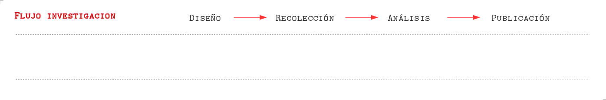{fig-align="center"}

## Flujo de investigación científica y ciencia abierta

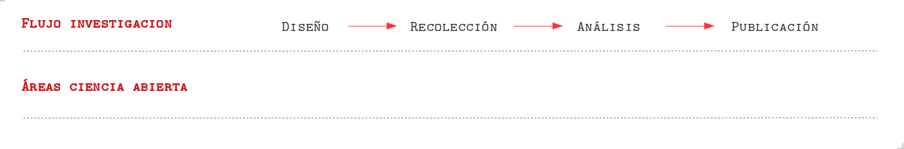{fig-align="center"}

# 1. Transparencia {background-color="#a81014"}

## Flujo de investigación científica y ciencia abierta

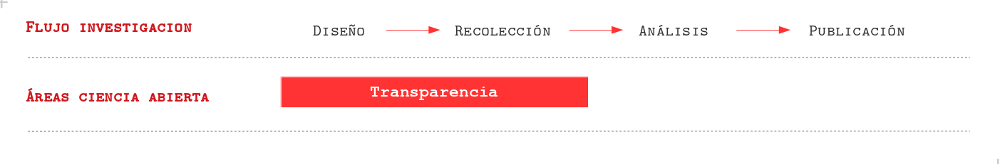{fig-align="center"}

## Transparencia 1: Diseño

:::{.incremental}
- Presión por publicar resultados "relevantes" (rechazar $H_0$)

- [HARKing]{.red}: *Hypothesis After the Results are Known*

  - Se adaptan las hipótesis y teorías a los resultados

  - Barreras al avance del conocimiento ya que solo conocemos lo que "resulta"
:::

## Transparencia 2: Datos

:::{.incremental}
- Dificultades en el acceso y la documentación de la información levantada en la investigación

- Barreras a la reproducibilidad y al avance de investigaciones con datos muchas veces levantados con fondos públicos
:::

# 2. Reproducibilidad {background-color="#a81014"}

## Reproducibilidad

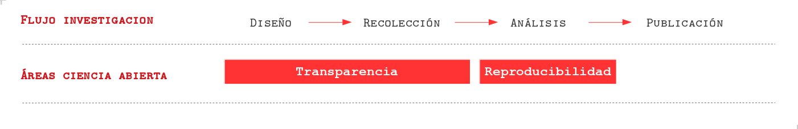{fig-align="center"}

## ¿Qué porcentaje de los estudios publicados son reproducibles?

::::{.columns}
:::{.column width="70%"}
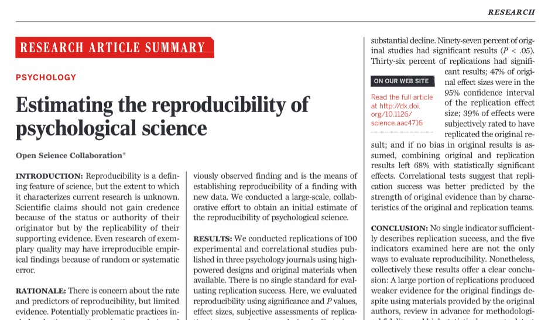{width="95%"}
:::

:::{.column width="30%" .fragment}
    
... alrededor de un **40%!** (varía por disciplina)
:::
::::

## ¿Por qué ocurre la crisis de reproducibilidad?

Algunas razones:

:::{.incremental}
- pobre documentación metodológica

- sesgo hacia búsqueda y publicación de resultados significativos (*p-hacking*), atribuido a la presión por publicar

- en algunos casos, falseamiento de datos/análisis
:::

# 3. Acceso {background-color="#a81014"}

## Acceso

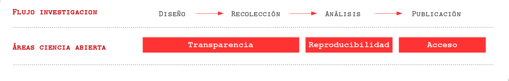{fig-align="center"}

## El ciclo actual de publicación científica

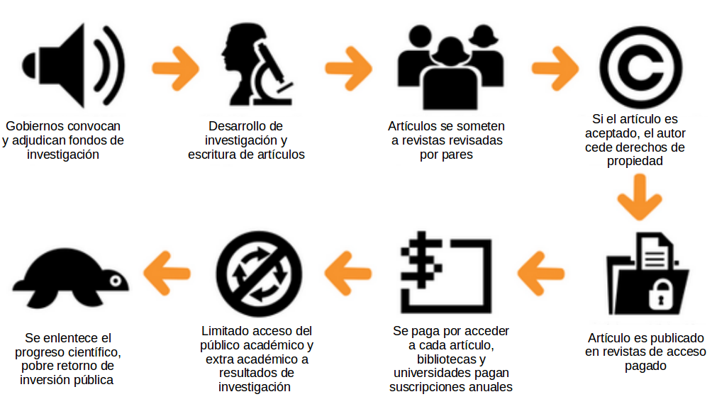{fig-align="center" width="65%"}

::: {.tiny style="text-align:right"}
(Adaptado de: <https://creativecommons.org/about/program-areas/open-access/>)
:::

## Barreras de pago {.center}

{fig-align="center" width="55%"}

## Modelo de publicación científica

::::{.columns}
:::{.column width="35%"}

:::

:::{.column width="65%"}
:::{.incremental}
- las vacas hacen leche (se ordeñan solas)

- otras vacas revisan la leche (gratis)

- las vacas le pagan al granjero para distribuir la leche

- luego el granjero le vende la leche de vuelta a las vacas
:::
:::
::::

## Márgenes de ganancia

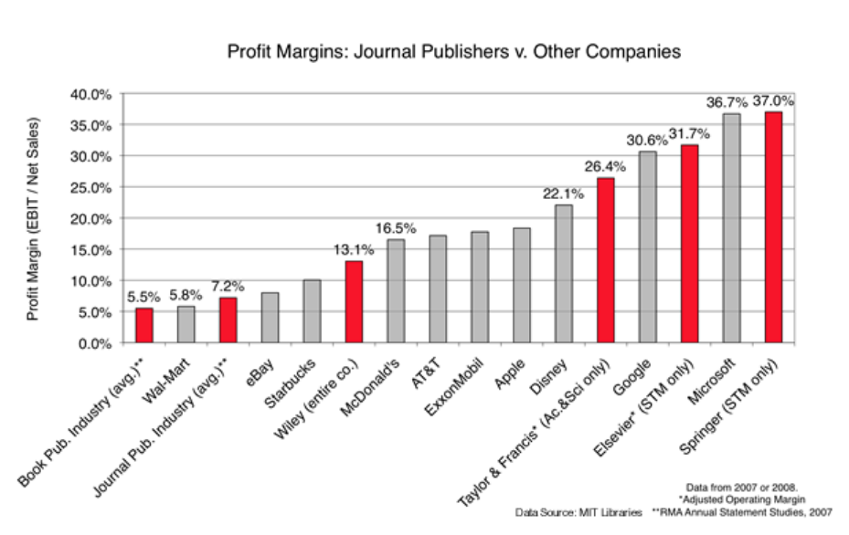{fig-align="center" width="70%"}

## Beneficios del acceso abierto

::::{.columns}
:::{.column width="25%"}
  

::: {.tiny}
Adaptado de: <http://whyopenresearch.org/>
:::
:::

:::{.column width="75%"}
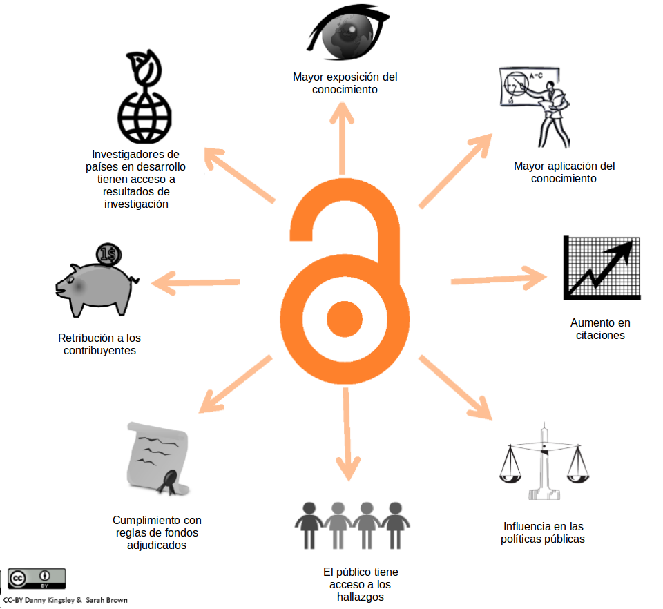{fig-align="center" height="640px"}
:::
::::

## Enfrentando la crisis

:::{.incremental}
- tema de **ética** científica y también de **eficiencia**

- por ahora en Chile, la apertura depende en gran parte de la **voluntad de los investigadores**, pero ...

- crecientemente financistas y medios de publicación se hacen **más exigentes**; gobiernos extranjeros ya han implementado políticas de transparencia, acceso y reproducibilidad

- necesidad de **herramientas metodológicas**
:::

# Principios de la ciencia {background-color="#a81014"}

## Ciencia abierta: vuelta a los principios de la ciencia (Merton)

:::{.incremental}
- **Universalismo**: cualquier persona puede contribuir al conocimiento científico, independiente de su origen.

- **Comunalidad**: los hallazgos de la ciencia pertenecen a la comunidad y no a quién los descubrió.

- **Desinterés**: la conducta de investigadores debe estar orientada por la búsqueda de la verdad, no con intereses personales ni monetarios.

- **Escepticismo organizado**: los hallazgos no se aceptan porque sí, se requieren pruebas.
:::

## ¿Se cumplen los principios de la ciencia?

- Investigación de Anderson et al. (2007), pregunta a más de 3000 investigadores sobre cumplimiento de principios de la ciencia mertonianos (agregan dos más: gobernanza y calidad)

- Dos grupos de académicos: carrera temprana y carrera intermedia

- Para todos los principios identifica normas y contra-normas

## Normas y contra-normas de la ética científica (Anderson, 2007)

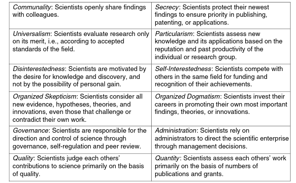{fig-align="center" width="70%"}

## Normas y contra-normas de la ética científica (Anderson, 2007)

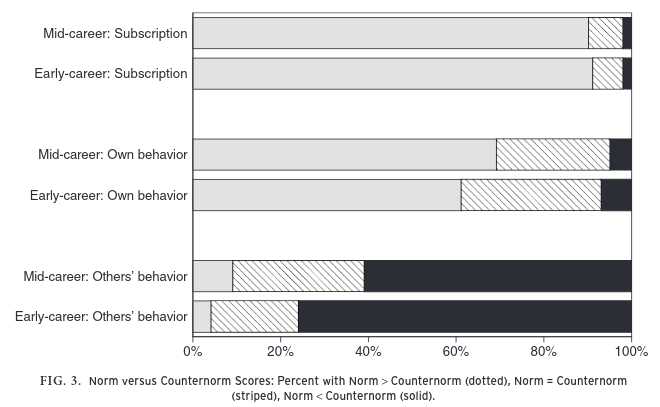{fig-align="center" width="70%"}

# Problemas de apertura {background-color="#a81014"}

##

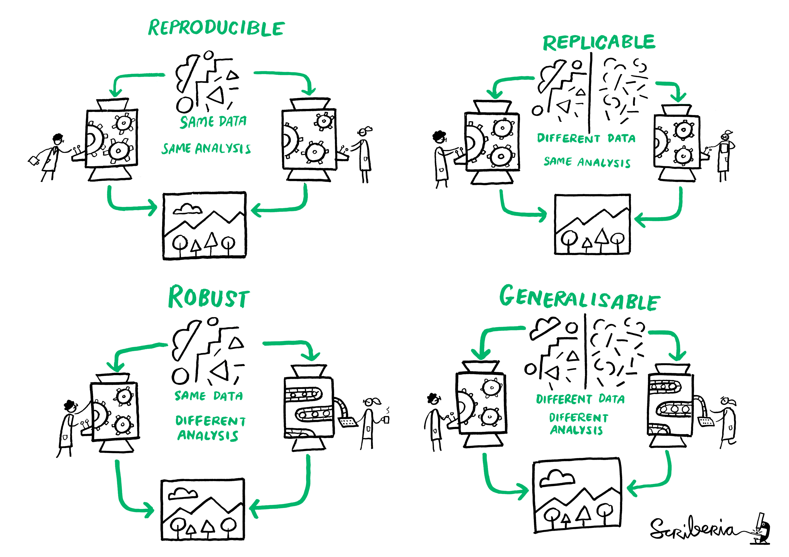{fig-align="center" width="75%"}

##

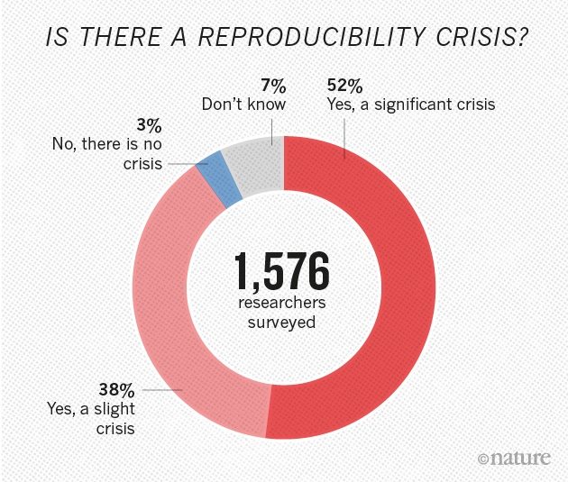{fig-align="center"}

::: {.small style="text-align:center"}
Fuente: [Baker (2016) 1,500 scientists lift the lid on reproducibility - Nature](https://www.nature.com/news/1-500-scientists-lift-the-lid-on-reproducibility-1.19970)
:::

##

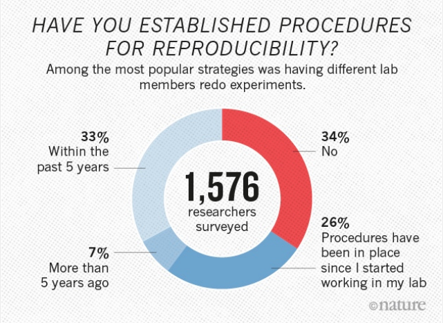{fig-align="center"}

::: {.small style="text-align:center"}
Fuente: [Baker (2016) 1,500 scientists lift the lid on reproducibility - Nature](https://www.nature.com/news/1-500-scientists-lift-the-lid-on-reproducibility-1.19970)
:::

##

::::{.columns}
:::{.column width="70%"}
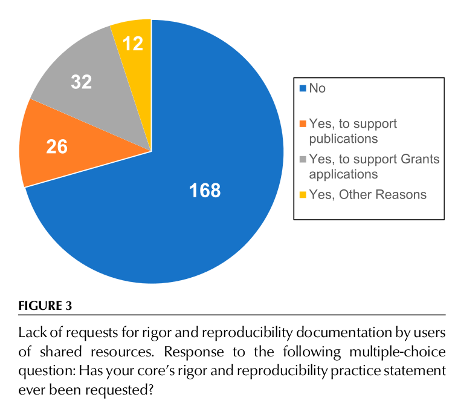{width="90%"}
:::

:::{.column width="30%"}
::: {.tiny}
[Knudtson, K. L., et al. (2019). Survey on Scientific Shared Resource Rigor and Reproducibility. *Journal of Biomolecular Techniques*, 30(3), 36–44. https://doi.org/10.7171/jbt.19-3003-001](https://pubmed.ncbi.nlm.nih.gov/31452645/)
:::
:::
::::

##

::::{.columns}
:::{.column width="55%"}

:::

:::{.column width="45%"}

:::
::::

# Presión por publicar {background-color="#a81014"}

##

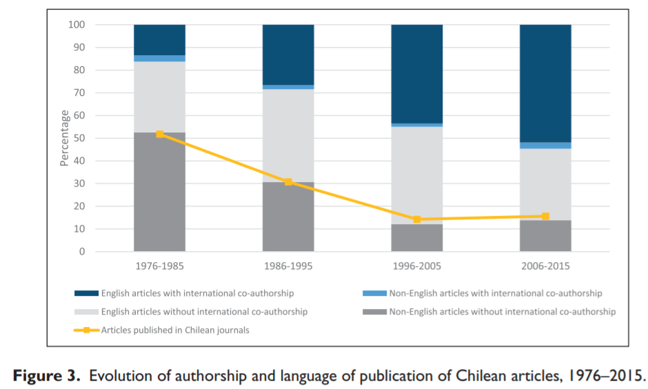{fig-align="center" width="75%"}

::: {.tiny}
[Koch, T., & Vanderstraeten, R. (2019). Internationalizing a national scientific community? Changes in publication and citation practices in Chile, 1976–2015. *Current Sociology*, 67(5), 723–741. https://doi.org/10.1177/0011392118807514](https://journals.sagepub.com/doi/10.1177/0011392118807514)
:::

## Cultura de "publica o perece" (*publish or perish*)

### Posibles correlatos:

:::{.incremental}
- Temor a que "te roben la idea" → evitar poner datos/código a disposición de terceros

- *p-hacking*: "presionar los datos" para rechazar la hipótesis nula

- falseamiento de datos
:::

##

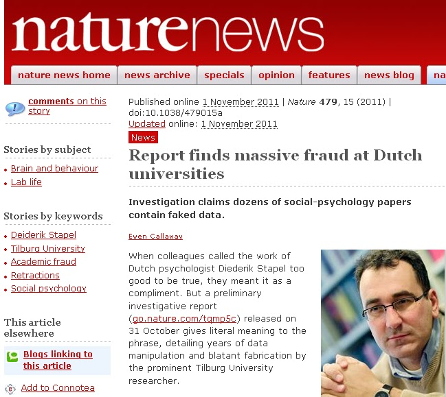{fig-align="center"}

## Franco et al. (2014): sesgo de publicación

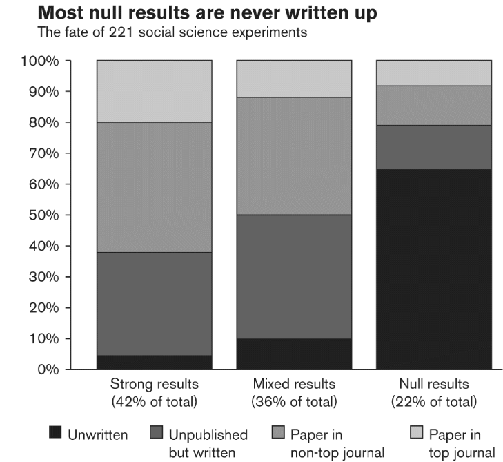{fig-align="center" width="50%"}

## ¿Alternativas? {background-color="#211e1e" .white}

:::{.incremental style="font-size:55px; font-weight:bold;"}
- Estándares
- Herramientas
- Incentivos
:::

##

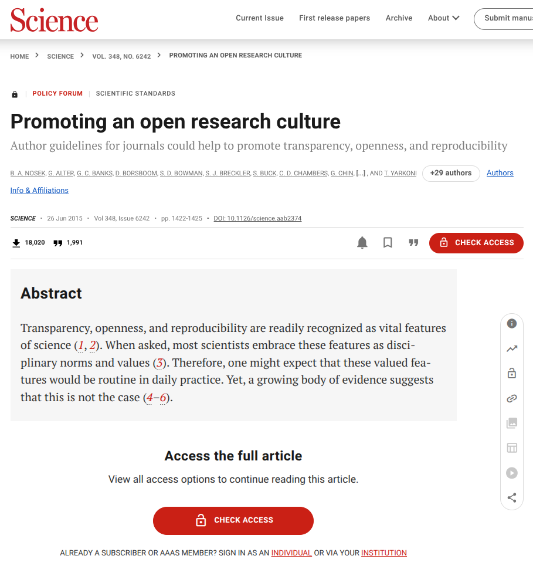

##

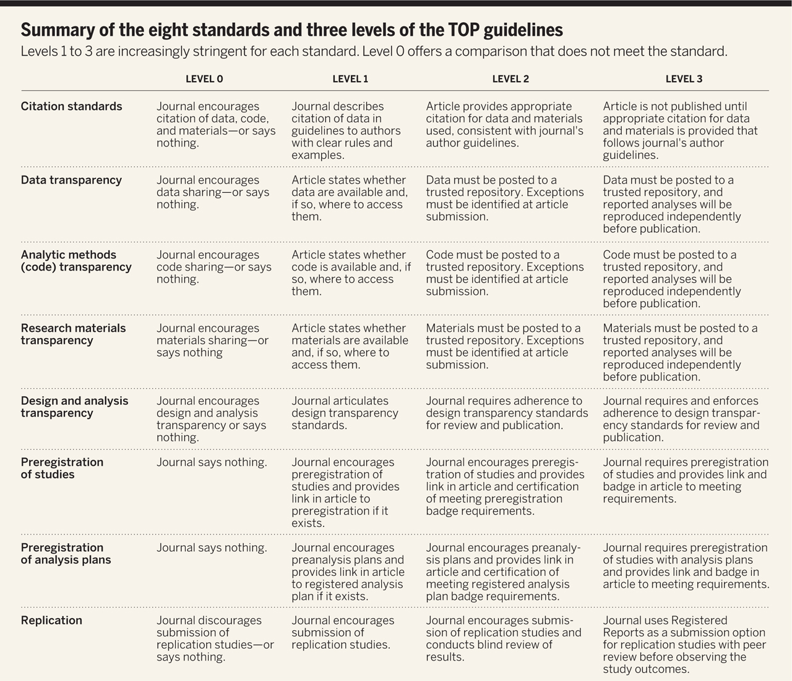{fig-align="center" width="65%"}

::: {.small style="text-align:right"}
[Nosek et al. (2015)](https://science.sciencemag.org/content/348/6242/1422)
:::

# Herramientas {background-color="#a81014"}

## {.center}

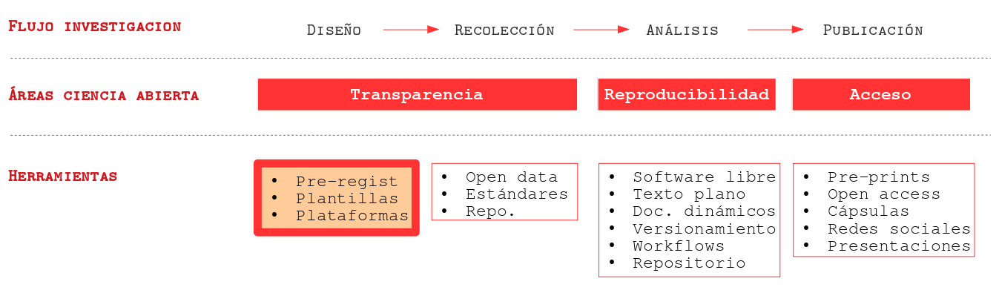{fig-align="center"}

## Un caso

:::{.incremental}
- Angélica está investigando la relación entre género e ingresos.

- No encuentra los resultados esperados en base a su hipótesis (mujeres obtienen menores ingresos)

- Luego ajusta la variable ingresos de continua a categórica, saca algunos *outliers* y obtiene una diferencia significativa con probabilidad de error p < 0.05

- Luego elimina a mujeres menores de 30 años y con muy bajo nivel educacional, y obtiene un p < 0.01
:::

::: {.fragment style="text-align:center; font-size:70px; font-weight:bold; color:#a81014;"}
¿Problema?
:::

##

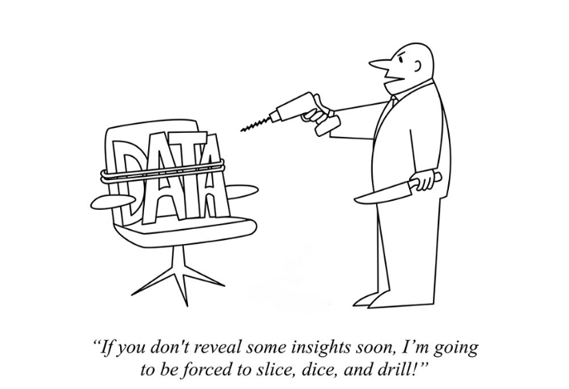{fig-align="center" width="75%"}

## Algunas (malas) prácticas

- presentar resultados exploratorios como si fueran guiados por teorías

  - **HARKing** (*Hypothesizing After Results are Known*)

- buscar/reportar selectivamente aquellos resultados que sí calzan con las hipótesis

  - ***p-hacking***

## Consecuencias

:::{.incremental}
- el problema *no es la exploración de datos*, sino su uso en reporte selectivo de resultados de investigación

- incrementa la posibilidad de rechazar erróneamente $H_0$

- exageraciones de efectos estimados, perjudicando la replicabilidad

- se confirma lo que uno está buscando, no lo que entregan los datos (y pierde sentido el recolectar datos y hacer investigación empírica)
:::

## Una solución: [pre-registro]{.orange}

- se crea un registro permanente y disponible del plan del estudio [antes de mirar los datos]{.orange}

- fechado e inmodificable

- accesible fácilmente y con opción de resguardo de anonimato de autores

- objetivo principal: diferenciar aspectos especificados *a priori* (hipótesis y análisis) de aquellos más exploratorios

## Ventajas de los pre-registros

::::{.columns}
:::{.column width="55%"}
- transparencia

- eficiencia

- mantener el foco en la teoría

- [no impide explorar]{.red}, solo diferenciar bien exploración de hipótesis
:::

:::{.column width="45%"}
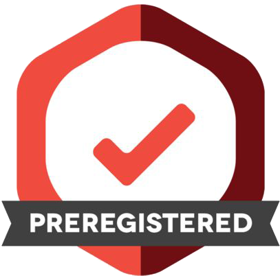
:::
::::

## Hombros de gigante vs. conejos del sombrero

::::{.columns}
:::{.column width="50%" .text-center}
{width="20%"}

{width="60%"}
:::

:::{.column width="50%" .text-center}
{width="20%"}

{width="75%"}
:::
::::

## Tipos de pre-registro

:::{.incremental}
- **Pre-registro (sin revisión)**: simplemente detallar hipótesis, datos y análisis y registrar en repositorio apropiado

- **Reporte registrado** (con revisión):
  - se somete a revisión en revista que permita esta opción
  - de ser aceptado, se publicará independiente de sus resultados
  - permite lidiar con el sesgo de publicación

- **Reporte pre-registrado de replicación**: específico para estudios de réplica de investigación
:::

## Plantillas de pre-registro (*templates*)

- formato de pre-registro que especifica campos a completar con información necesaria

- distintas alternativas

- asociadas a plataformas y plantillas de publicación

- Más conocidas:

  - [AsPredicted](https://aspredicted.org/)
  - [Open Science Framework - OSF](https://osf.io/)

## Campos típicos e información apropiada {.scrollable}

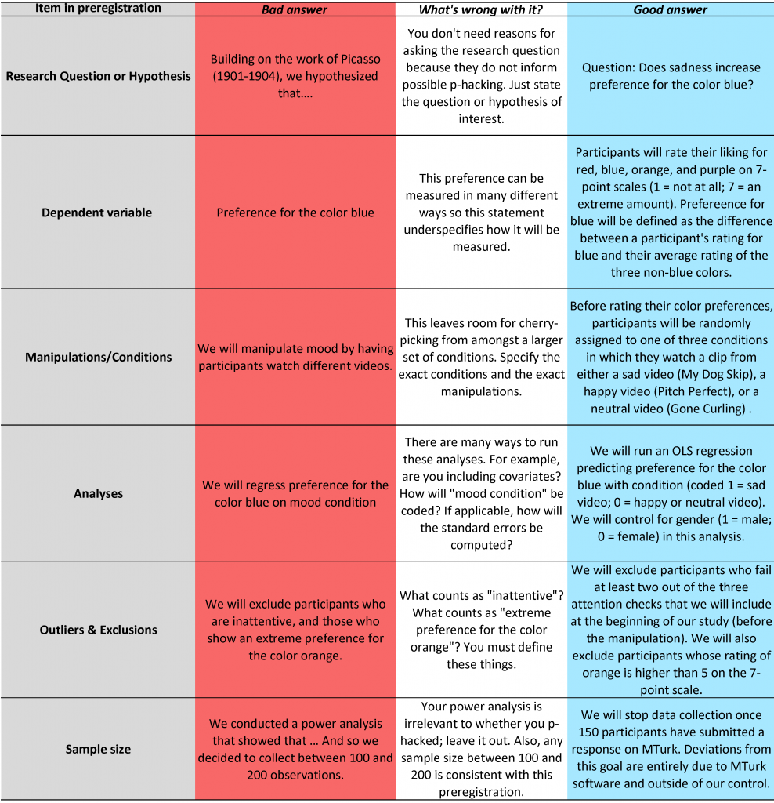{fig-align="center" width="50%"}

## AsPredicted

[{width="40%"}](https://aspredicted.org/)

- desarrollado por el [Credibility Lab](https://credlab.wharton.upenn.edu/) de Wharton

- formulario simple y rápido en línea

- queda almacenado y disponible

## Open Science Framework (OSF) {.center}

::::{.columns}
:::{.column width="30%"}
[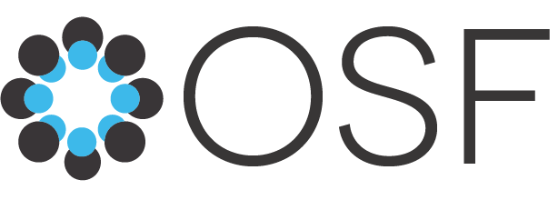{width="90%"}](https://osf.io/)
:::

:::{.column width="70%"}
- entorno de apertura de proyectos de investigación completos (más allá de los pre-registros)

- se pueden pre-registrar estudios asociados a un proyecto ya generado en OSF, o de manera independiente

- disponibilidad de [múltiples plantillas de pre-registro](https://osf.io/zab38/wiki/home/)
:::
::::

##

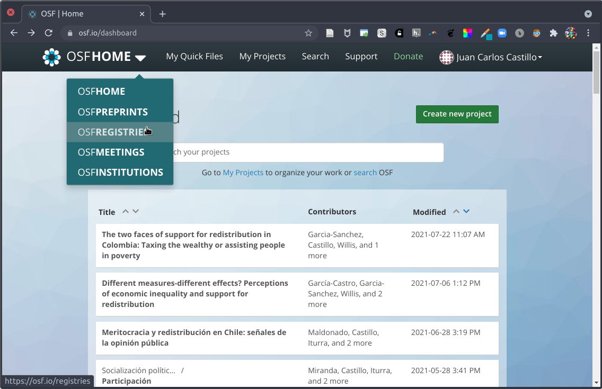{fig-align="center" width="80%"}

##

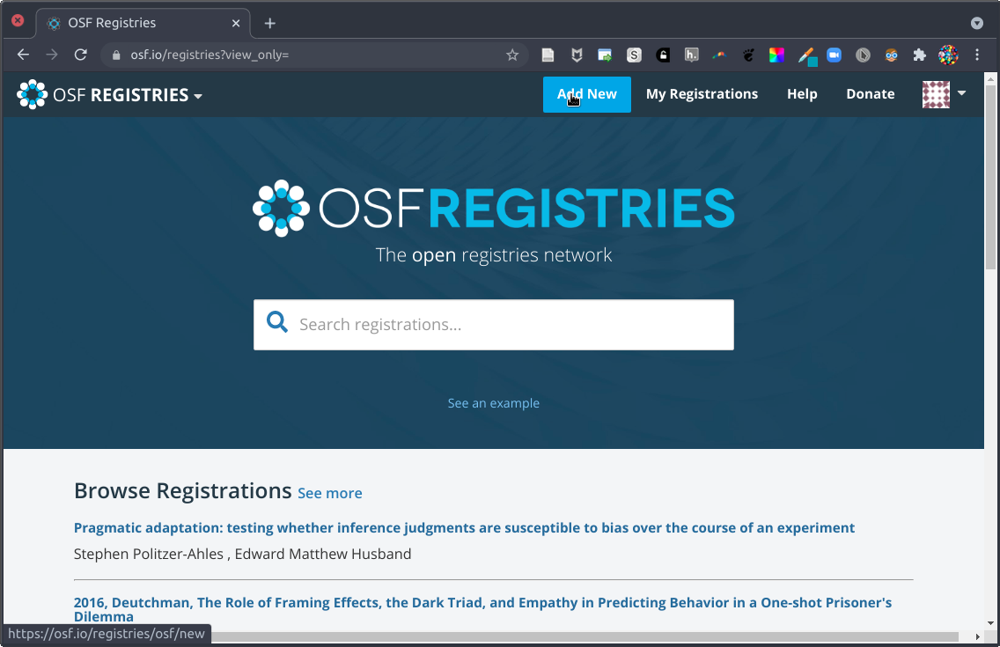{fig-align="center" width="80%"}

##

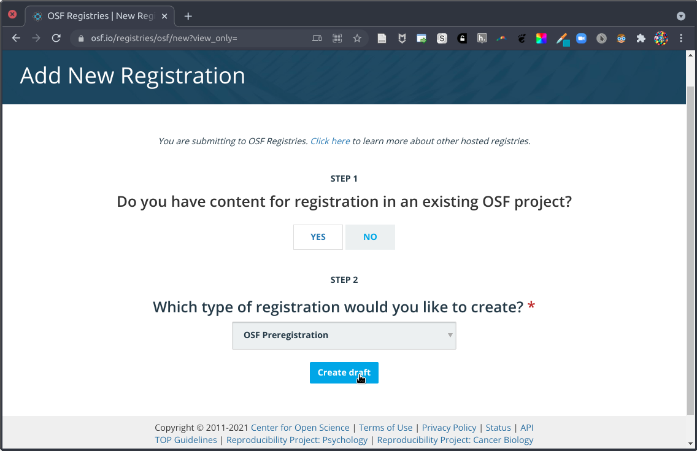{fig-align="center" width="80%"}

## Referencias sobre pre-registro

- [How To Properly Preregister A Study - Data Colada](http://datacolada.org/64)

- [Lindsay et al. (2016) Research Preregistration 101.](https://www.psychologicalscience.org/observer/research-preregistration-101)

- [Nosek, B. A., Ebersole, C. R., DeHaven, A. C., & Mellor, D. T. (2018). The preregistration revolution. *PNAS*, 115(11), 2600–2606. https://doi.org/10.1073/pnas.1708274114](https://www.pnas.org/content/115/11/2600)

- [OSF Preregistration resources](https://www.cos.io/initiatives/prereg)

## {.center}

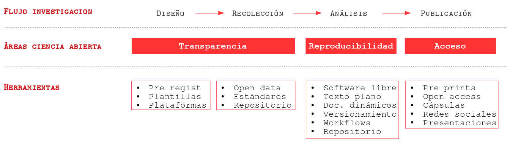{fig-align="center"}

## Open Science Framework

::::{.columns}
:::{.column width="25%"}
[Open Science Framework]{style="font-size:60px; font-weight:bold; color:#c02424;"}
:::

:::{.column width="75%"}
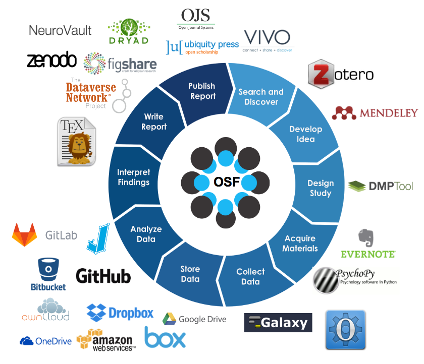{fig-align="center"}
:::
::::

## Juntando las piezas

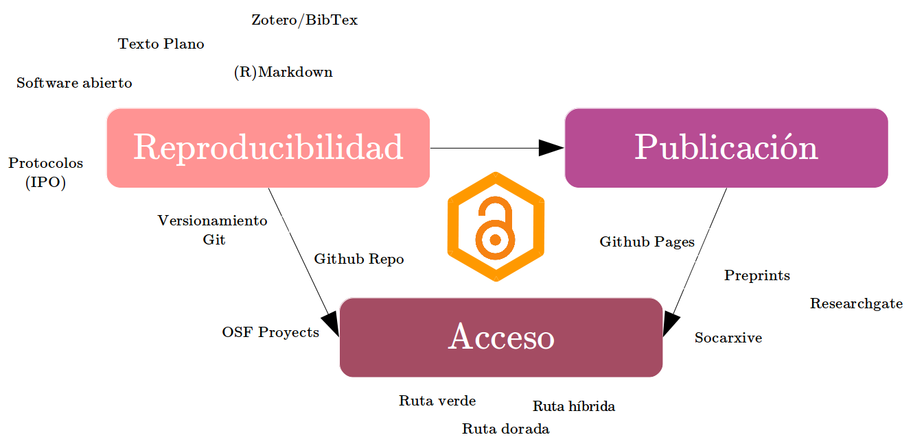{fig-align="center"}

# Acceso a las publicaciones {background-color="#a81014"}

## Bases: Declaración de Budapest 2002

[Budapest Open Access Initiative](https://www.budapestopenaccessinitiative.org/read)

::: {.medium}
> *By [“open access”]{.red} to this literature, we mean its **free availability on the public internet**, permitting any users to read, download, copy, distribute, print, search, or link to the full texts of these articles, crawl them for indexing, pass them as data to software, or use them for any other lawful purpose, without financial, legal, or technical barriers other than those inseparable from gaining access to the internet itself.*
>
> *The [only constraint]{.red} on reproduction and distribution, and the only role for copyright in this domain, should be to give **authors control over the integrity of their work** and the right to **be properly acknowledged and cited.***
:::

## Bases: Declaración de Berlín 2003

[Berlin Declaration](https://openaccess.mpg.de/67605/berlin_declaration_engl.pdf)

::: {.medium}
1. The author(s) and right holder(s) of such contributions grant(s) to all users a free, irrevocable, worldwide, right of access to, and a license to copy, use, distribute, transmit and display the work publicly ...

2. A complete version of the work and all supplemental materials, including a copy of the permission as stated above, in an appropriate standard electronic format is deposited (and thus published) in at least one online repository
:::

::: {.small}
Más información: [European Commission Open Access](https://ec.europa.eu/research/participants/docs/h2020-funding-guide/cross-cutting-issues/open-access-data-management/open-access_en.htm)
:::

# Rutas de accesibilidad {background-color="#211e1e"}

##

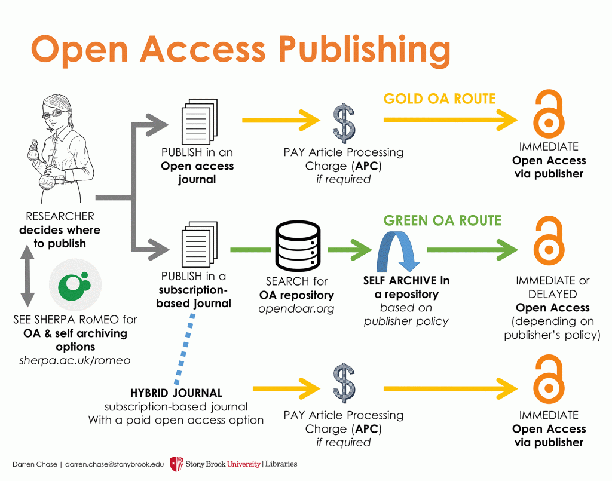{fig-align="center" width="70%"}

##

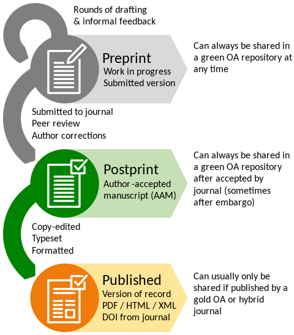{fig-align="center"}

## Políticas de acceso de las revistas {.center}

Información sobre políticas de acceso de las revistas: <https://v2.sherpa.ac.uk/romeo/>

# Pre-prints {background-color="#a81014"}

## Pre-prints

:::{.incremental}
- Los *preprints* o pre-impresos son publicaciones abiertas de un reporte de investigación, por lo general un artículo, antes de un proceso de revisión por pares

- El objetivo general es hacer disponibles y difundir reportes de investigación

- Son referenciables / citables / accesibles

- Pueden ser una versión inicial/borrador o una versión final

- Concepto general: **ciencia en tiempo real**
:::

##

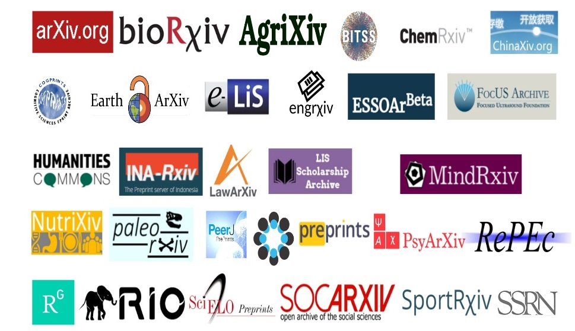{fig-align="center"}

##

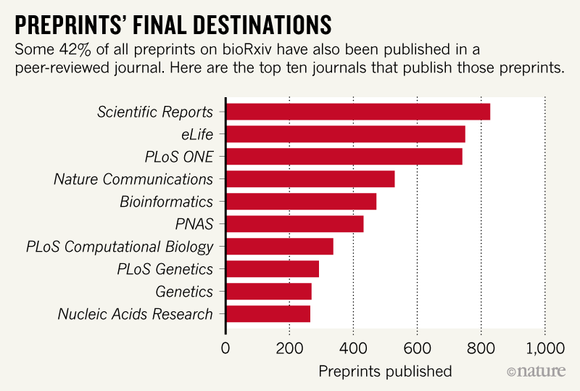{fig-align="center" width="65%"}

::: {.small}
<https://www.natureindex.com/news-blog/what-biorxivs-first-thirty-thousand-preprints-reveal-about-biologists>
:::

##

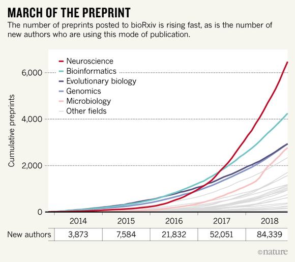{fig-align="center" width="60%"}

##

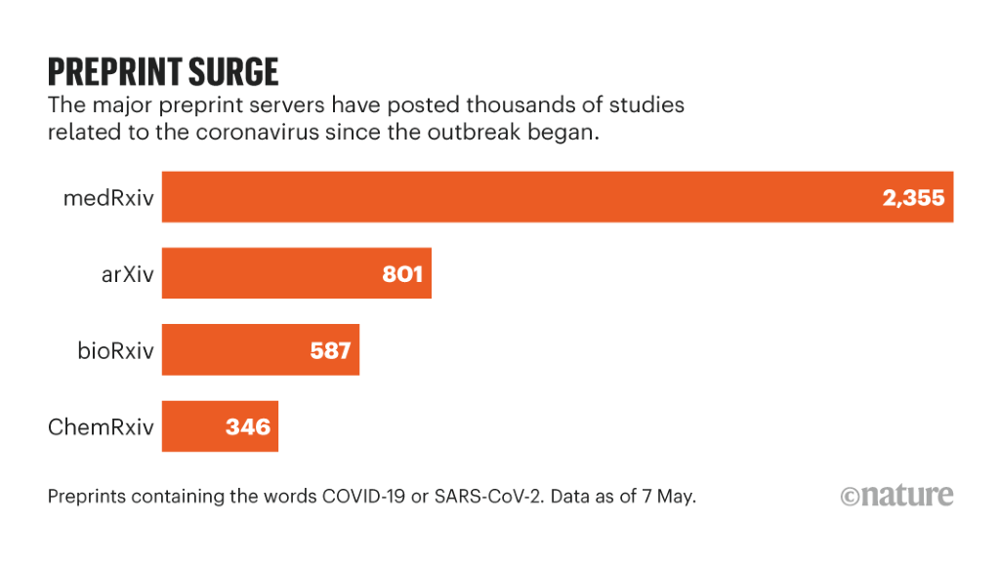{fig-align="center"}

##

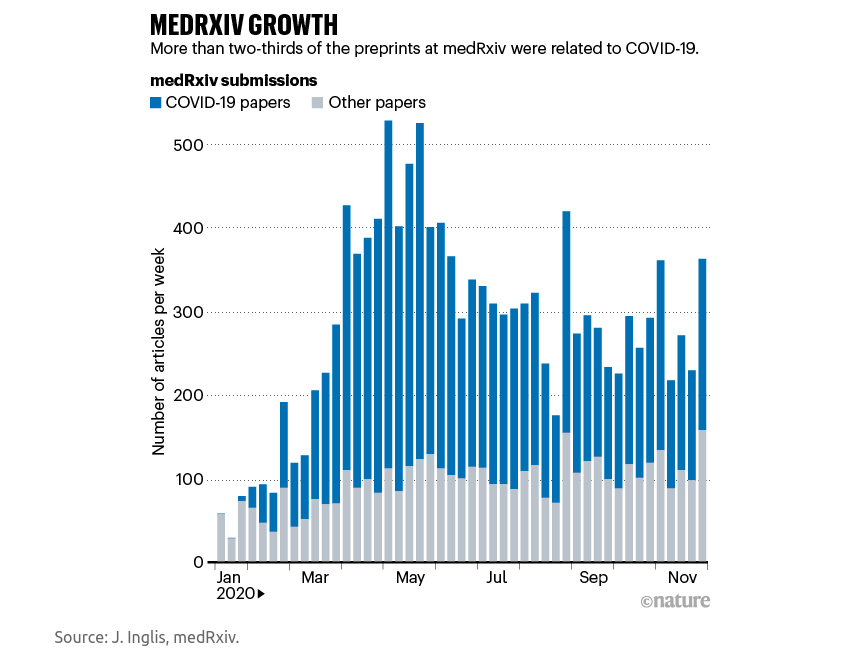{fig-align="center"}

## SocArXiv

::::{.columns}
:::{.column width="30%"}

[socopen.org](https://socopen.org/)
:::

:::{.column width="70%"}
- Servicio de pre-prints de ciencias sociales vinculado al OSF

- Permite subir documentos (pdf) fácilmente desde proyectos OSF

- Tiene un sistema de *moderación*: un equipo de moderadores realiza un filtro grueso para determinar el carácter académico del pre-print

- Otorga un DOI (*digital object identifier*), que permite su citación y rastreo académico
:::
::::

##

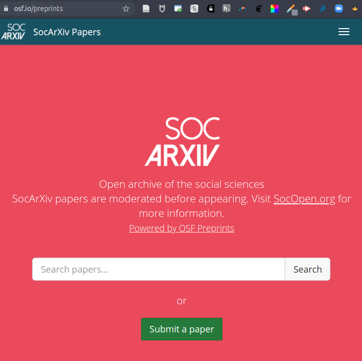{fig-align="center" width="55%"}

##

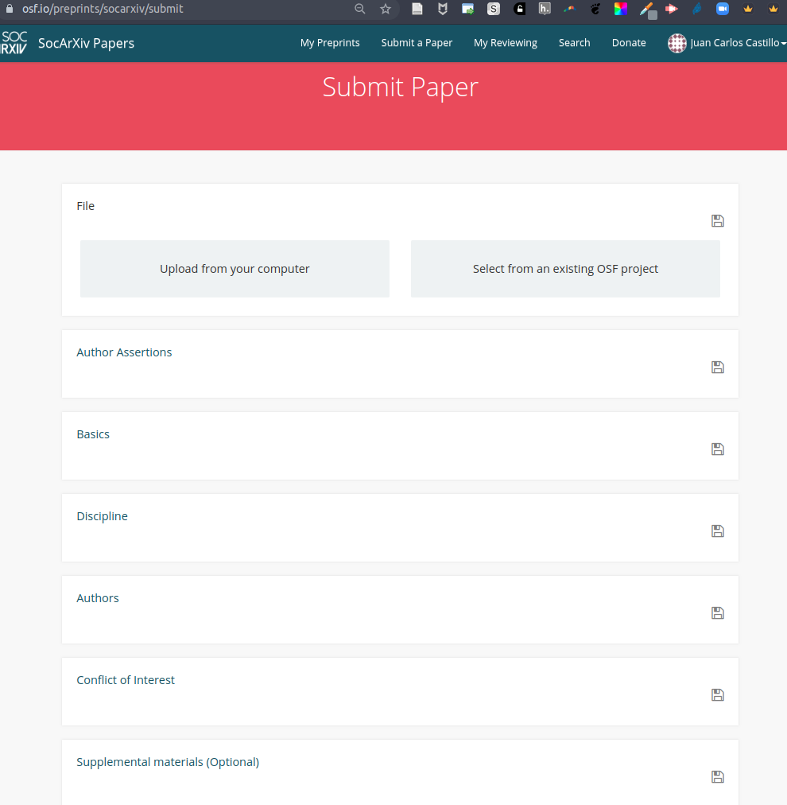{fig-align="center" width="55%"}

## Sobre las licencias de trabajos abiertos

- permiten resguardar el derecho de propiedad y reconocimiento (atribución) de quienes crean la obra

- diferentes elementos:
  - posibilidad de "derivar" (adaptar) y publicar un nuevo producto
  - posibilidad de generar derivados comerciales
  - posibilidad de que derivados tengan distintas licencias

- más información: <https://creativecommons.org/licenses/>

## Resumen {background-color="#211e1e" .white}

- Crisis de reproducibilidad y acceso

- Principios de la ciencia y ética de la investigación social

- Algunas herramientas

  - Pre-registros
  - Pre-prints

# {.portada background-gradient="linear-gradient(135deg, #5c0709 0%, #a81014 55%, #c02424 100%)"}

::::{.columns}
:::{.column width="68%"}
[Ética de Investigación en Ciencias Sociales · 2026]{.kicker}

[Ciencia Abierta]{.titulo}
[e Investigación Social]{.subtitulo}

[]{.acento}

[Prof. Juan Carlos Castillo]{.autor}
[Departamento de Sociología · Universidad de Chile]{.afiliacion}
[2do Semestre 2026]{.afiliacion}
:::

:::{.column width="32%" .logo-col}
{.logo-oa}
:::
::::
