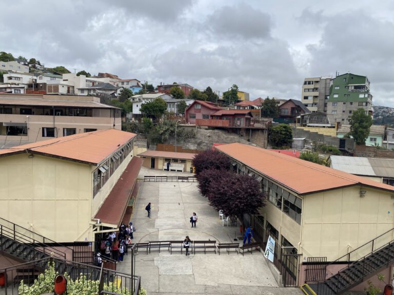

<!-- <link rel="me" href="https://mastodon.social/@hegang"> -->

<!-- <!--This is my personal clarity, please delete or replace with your own clarity-->
<!--  -->

:::{#hero-heading}

¡Bienvenid_ a mi sitio! Acá busco poner a disposición mi trabajo académico de investigación, docencia y extensión de la manera más abierta posible.

Soy profesor titular en el **Departamento de Sociología de la Universidad de Chile**. Actualmente soy presidente del [Research Committee 42 (Social Psychology)](https://isa-rc42.org/) de la [International Sociological Association](https://www.isa-sociology.org/), y miembro del Scientific Advisory Board del [Social Science Research Center Berlin (WZB)](https://www.wzb.eu/). 

Realicé mi doctorado en sociología en el [Instituto de Ciencias Sociales](https://www.sowi.hu-berlin.de/de) de la [Universidad de Humboldt](https://www.hu-berlin.de/de), Berlin. Desde entonces me dedico principalmente a la investigación en temas de justicia distributiva desde una metodología cuantitativa, utilizando metodos multinivel, ecuaciones estructurales, y herramientas de ciencia abierta. Actualmente, mi foco de investigación se centra en meritocracia y merecimiento utilizando experimentos de encuestas y análisis de datos de panel, en el márco de mi proyecto FONDECYT Regular 2025-2028 ["JUSMER: Justicia de Mercado y Merecimiento del Bienestar Social"]()

Anteriormente fui subdirector e investigador principal del [Centro de Estudios de Conflicto y Cohesión social COES](https://coes.cl/) (2013-2025), e investigador principal del [Núcleo Milenio de Desigualdades y Oportunidades Digitales NUDOS](https://www.nudos.cl/) (2023-2025). Fui profesor en el Instituto de Sociología de la Pontificia Universidad Católica de Chile (2014-2018) y coordinador del área de investigación del Centro de Medición MIDE UC (2010-2013).

Estudié en la <span class="hover-image-wrapper"> escuela 227 de Miraflores, Viña del Mar  </span>. Y nací en  [Quilpué, _Ciudad del Sol_ ... y de crímenes macabros](https://www.google.com/search?q=cr%C3%ADmenes+en+quilpu%C3%A9).

<!-- Links extra para la fila de íconos (el template "about" solo admite bootstrap icons) -->
```{=html}
<div id="links-extra" class="d-none">
  <a href="https://www.researchgate.net/profile/Juan-Castillo-18" class="about-link" title="ResearchGate" aria-label="ResearchGate">
    <svg class="icono-extra icono-rg" xmlns="http://www.w3.org/2000/svg" viewBox="0 0 24 24" aria-hidden="true"><path fill="currentColor" d="M19.586 0q-1.226.001-2.073.565q-.846.565-1.213 1.68a3 3 0 0 0-.112.437a8 8 0 0 0-.078.53a9 9 0 0 0-.05.727q-.014.423-.013 1.016a31.121 31.123 0 0 0 .014 1.017a9 9 0 0 0 .05.727a8 8 0 0 0 .077.53h-.005a3 3 0 0 0 .113.438q.368 1.114 1.214 1.68q.847.564 2.075.564c.8 0 1.536-.213 2.105-.603c.57-.39.94-.916 1.175-1.65c.076-.235.135-.558.177-.93a11 11 0 0 0 .043-1.207v-.82q0-.142-.14-.142h-3.064q-.14 0-.14.141v.956q0 .14.14.14h1.666q.084.001.084.086c0 .36 0 .62-.036.865c-.038.244-.1.447-.147.606c-.108.385-.348.664-.638.876s-.738.35-1.227.35c-.545 0-.901-.15-1.21-.353c-.306-.203-.517-.454-.67-.915a3 3 0 0 1-.147-.762a17.366 17.367 0 0 1-.034-.656q-.015-.39-.014-.939a26.401 26.403 0 0 1 .014-.938a16 16 0 0 1 .035-.656a3.2 3.2 0 0 1 .148-.76a1.9 1.9 0 0 1 .742-1.01c.344-.244.593-.352 1.137-.352c.508 0 .815.096 1.144.303c.33.207.528.492.764.925q.069.141.198.07l1.044-.43q.113-.072.042-.199a3.6 3.6 0 0 0-.466-.742a3 3 0 0 0-.679-.607a3.3 3.3 0 0 0-.903-.41A4 4 0 0 0 19.586 0M8.217 5.836c-1.69 0-3.036.086-4.297.086c-1.146 0-2.291 0-3.007-.029v.831l1.088.2c.744.144 1.174.488 1.174 2.264v11.288c0 1.777-.43 2.12-1.174 2.263l-1.088.2v.832c.773-.029 2.12-.086 3.465-.086c1.29 0 2.951.057 3.667.086v-.831l-1.49-.2c-.773-.115-1.174-.487-1.174-2.264v-4.784c.688.057 1.29.057 2.206.057c1.748 3.123 3.41 5.472 4.355 6.56c.86 1.032 2.177 1.691 3.839 1.691c.487 0 1.003-.086 1.318-.23v-.744c-1.031 0-2.063-.716-2.808-1.518c-1.26-1.376-2.95-3.582-4.355-6.074c2.32-.545 4.04-2.722 4.04-4.9c0-3.208-2.492-4.698-5.758-4.698zm-.515 1.29c2.406 0 3.839 1.26 3.839 3.552c0 2.263-1.547 3.782-4.097 3.782c-.974 0-1.404-.03-2.063-.086v-7.19c.66-.059 1.547-.059 2.32-.059z"/></svg>
  </a>
  <a href="https://isa-rc42.org/" class="about-link" title="ISA RC42 Social Psychology" aria-label="ISA RC42 Social Psychology">
    
  </a>
</div>
<script>
document.addEventListener("DOMContentLoaded", () => {
  const destino = document.querySelector(".about-links");
  const extra = document.getElementById("links-extra");
  if (!destino || !extra) return;
  extra.querySelectorAll("a").forEach((a) => destino.appendChild(a));
  extra.remove();
});
</script>
```

<br>
<br>
<br>

:::

<!-- ## Recent Posts -->
<!-- Check out the latest &nbsp;[Papers](posts.qmd#category=paper)&nbsp;, &nbsp;[News](posts.qmd#category=news)&nbsp;, &nbsp;[Events](posts.qmd#category=event)&nbsp;, and &nbsp;[More »](/posts.qmd) -->

::: {.parallax-container}
::: {.parallax-image-container}
::: {.section-block}
::: {style="text-align: center;"}

::: {#proyectosh1}
:::

<p align="left" style="font-size:36px; font-weight:bold;">Proyectos</p>

:::{#proyectos}
:::

::: {.button}
[Ver más](proyectos/proyectos.qmd){.btn-action-primary .btn-action .btn .btn-success .btn-lg role="button" style="margin-top: 0em;"}
:::


:::
:::
:::
:::

::: {.section-text .bloque-verde}
::: {.section-container}
::: {.section-block}
::: {style="text-align: left;"}
<br>

::: {#references/publicationsh1}
:::

<p align="left" style="font-size:36px; font-weight:bold;">Publications</p>

:::{#publications}
:::

::: {.button}
[Ver más](references/publications/index.qmd){.btn-action-primary .btn-action .btn .btn-success .btn-lg role="button" style="margin-top: 0em;"}
:::

:::
:::
:::
:::

::: {.section-text}
::: {.section-container}
::: {.section-block}
::: {style="text-align: left;"}
<br>

::: {#references/presentationsh1}
:::

<p align="left" style="font-size:36px; font-weight:bold;">Presentations</p>

:::{#presentations}
:::

::: {.button}
[Ver más](references/presentations/index.qmd){.btn-action-primary .btn-action .btn .btn-success .btn-lg role="button" style="margin-top: 0em;"}
:::

:::
:::
:::
:::


::: {.parallax-container .bloque-verde}
::: {.parallax-image-container}
::: {.section-block}
::: {style="text-align: left;"}


::: {#docenciah1}
:::

<p align="left" style="font-size:36px; font-weight:bold;">Docencia</p>

:::{#docencia}
:::

::: {.button}
[Ver más](docencia/docencia.qmd){.btn-action-primary .btn-action .btn .btn-success .btn-lg role="button" style="margin-top: 0em;"}
:::

:::
:::
:::
:::

::: {.section-text}
::: {.section-container}
::: {.section-block}
::: {style="text-align: left;"}


::: {#tesish1}
:::

<p align="left" style="font-size:36px; font-weight:bold;">Guía y Comité de Tesis</p>

:::{#tesis}
:::

::: {.button}
[Ver más](references/thesis/index.qmd){.btn-action-primary .btn-action .btn .btn-success .btn-lg role="button" style="margin-top: 0em;"}
:::

:::
:::
:::
:::

::: {.parallax-container .bloque-verde}
::: {.parallax-image-container2}
::: {.section-block}
::: {style="text-align: left;"}

::: {#blogh1}
:::

<p align="left" style="font-size:36px; font-weight:bold;">Post Recientes</p>

:::{#blog}
:::

::: {.button}
[Ver más](blog/blog.qmd){.btn-action-primary .btn-action .btn .btn-success .btn-lg role="button" style="margin-top: 0em;"}
:::

:::
:::
:::
:::

::: {.section-text}
::: {.section-container}
::: {.section-block}
::: {style="text-align: left;"}

::: {#herramientash1}
:::

<p align="left" style="font-size:36px; font-weight:bold;">Herramientas</p>

:::{#herramientas}
:::

::: {.button}
[Ver más](herramientas/herramientas.qmd){.btn-action-primary .btn-action .btn .btn-success .btn-lg role="button" style="margin-top: 0em;"}
:::

:::
:::
:::
:::

::: {.section-text .bloque-verde}
::: {.section-container}
::: {.section-block}
::: {style="text-align: left;"}

::: {#datah1}
:::

<p align="left" style="font-size:36px; font-weight:bold;">Data</p>

:::{#data}
:::

::: {.button}
[Ver más](data/data.qmd){.btn-action-primary .btn-action .btn .btn-success .btn-lg role="button" style="margin-top: 0em;"}
:::

:::
:::
:::
:::

::: {.section-text}
::: {.section-container}
::: {.section-block}
::: {style="text-align: left;"}

::: {#galeriah1}
:::

<p align="left" style="font-size:36px; font-weight:bold;">Galería</p>

:::{listing-gallery}
:::

:::
:::
:::
:::
